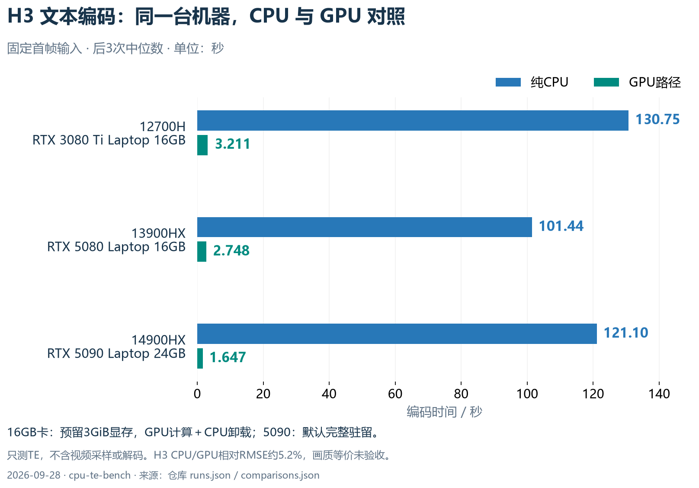
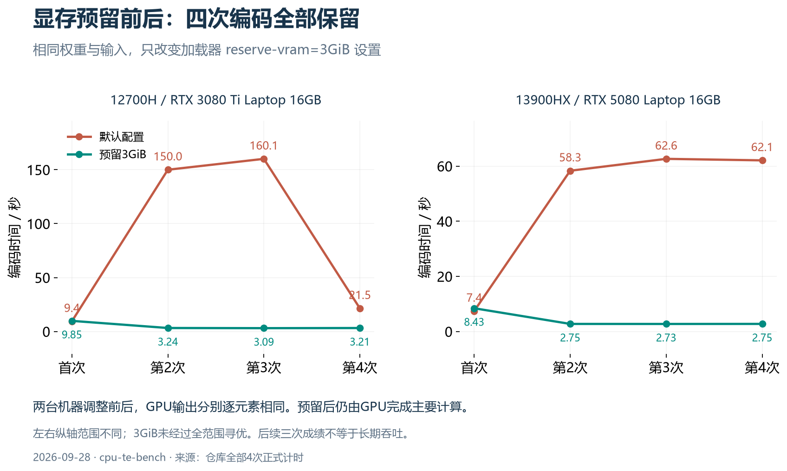
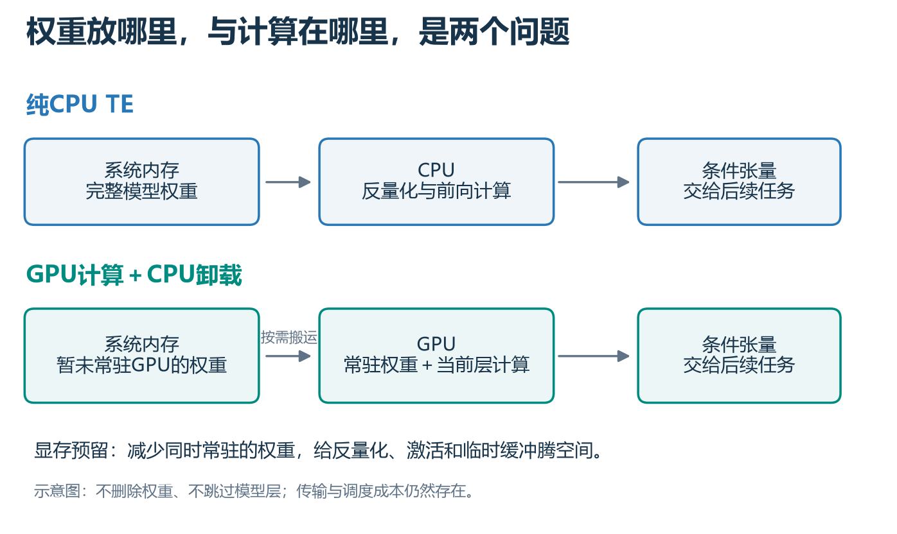

# CPU TE Bench: Measuring Text Encoding on the CPU

[简体中文](README.md) | **English**

Paired CPU–GPU benchmarks of Image and MiniMax H3 text encoders on Windows / ComfyUI: **three laptops, 80 timed encoding passes, with slow samples and limitations retained.**

This project grew out of a question in our “Herd / Pinhaoka” architecture experiments: when a single GPU has limited resources, can CPU devices handle text encoding while the GPU handles subsequent generation? We completed CPU forward passes and found that GPU memory allocation policy can also make a substantial difference. This repository contains experimental scripts and evidence, not a production service or a one-click video generator.

> **Current conclusion: on these three machines, prefer GPU execution with appropriate offloading. CPU-only execution is an option for fallback or idle resources, not a general speedup. H3 CPU/GPU outputs differ by approximately 5.2% relative RMSE; equivalent final image/video quality has not been verified.**

## Same-machine results

Measured on September 28, 2026. Times are in seconds. Each cell shows **CPU / GPU**, using the median of the last three passes; first-pass timings are listed separately in [all recorded timings](docs/RESULTS.md). “Short” and “long” refer to Image prompts, not output resolution or video duration.

| Same machine | Image: short input | Image: long input | H3: fixed first frame | H3 GPU configuration |
|---|---:|---:|---:|---|
| 12700H / RTX 3080 Ti Laptop 16GB | 15.13 / 0.236 | 51.57 / 1.728 | 130.75 / 3.211 | Reserve 3GiB; GPU compute + CPU offload |
| 13900HX / RTX 5080 Laptop 16GB | 8.19 / 0.181 | 39.54 / 1.418 | 101.44 / 2.748 | Reserve 3GiB; GPU compute + CPU offload |
| 14900HX / RTX 5090 Laptop 24GB | 9.87 / 0.137 | 34.15 / 0.892 | 121.10 / 1.647 | Default; weights fully resident on GPU |

These measurements cover TE encoding only; the H3 case also includes visual encoding of a fixed first frame. **They are not end-to-end image generation or five-second video generation times.** The CPU path forbids CUDA initialization and uses an FP32 compute configuration. The GPU path uses an independent TE loader with DynamicVRAM disabled. Image short/long outputs have 24/1016 positions; H3 has 441 positions.



*Figures currently have Chinese labels. Blue bars represent CPU-only execution; teal bars represent the GPU path. The values and configurations are also given in the English tables above and below.*

## A key finding: leaving GPU memory headroom made encoding faster

The default H3 configuration produced large timing fluctuations on both 16GB GPUs. In the additional runs, only the loader setting `--reserve-vram 3` changed; weights and inputs stayed the same.

| GPU | Default: four passes, seconds | Reserve 3GiB: four passes, seconds |
|---|---|---|
| RTX 3080 Ti Laptop | 9.448 / 149.974 / 160.068 / 21.477 | 9.851 / 3.235 / 3.087 / 3.211 |
| RTX 5080 Laptop | 7.432 / 58.316 / 62.629 / 62.080 | 8.430 / 2.748 / 2.734 / 2.755 |

For each machine, GPU outputs were elementwise identical before and after the change. Reserving headroom keeps more weights in system RAM and transfers them to the GPU when needed, leaving room for dequantization, activations, and temporary buffers. The main computation still happens on the GPU. The 3GiB setting is a loader budget, not a driver-enforced hard limit, and has not been established as a universally optimal value.



*Red: default configuration. Teal: reserve 3GiB. The horizontal axis shows the first through fourth passes. The two panels use different vertical scales.*



*Top: weights in system RAM → CPU dequantization and forward computation → conditioning tensors. Bottom: offloaded weights in system RAM → transfer as needed to GPU for computation → conditioning tensors. Reserving headroom does not remove weights, skip layers, or eliminate transfer costs.*

Consequently, an earlier GPU result of roughly 70 seconds is not a general baseline, and “CPU takes only about 30 seconds longer” is not an inherent property of H3. See [mechanisms and boundaries](docs/FINDINGS.md).

## What is included

- `scripts/bench.py`: an unchanged copy of the script actually used, with four CPU/GPU passes per case, memory guards, CUDA synchronization, and optional GPU profiling.
- `archive/bench-main.py`: the main-matrix version before the memory-reserve parameter was added.
- `results/2026-09-28/runs.json`: sanitized records for 14 process groups, including all 80 timed passes, memory/device information, weight/source hashes, and five profiler summaries.
- `results/2026-09-28/comparisons.json`: nine CPU/GPU numerical comparisons and two before/after memory-reserve comparisons.
- `scripts/analyze_recorded.py`: regenerates timing tables using only the Python standard library; it does not load a model.
- [Reproduction instructions](docs/REPRODUCE.md), [findings and unknowns](docs/FINDINGS.md), and [data dictionary](docs/DATA_DICTIONARY.md). These supporting documents are currently in Chinese; script arguments and recorded field names are in English.

Model weights, the original reference image, and output conditioning tensors are not distributed. **The H3 method can be reused with your own image, but the historical H3 sample cannot be reproduced byte-for-byte without the original image.** Numerical-difference summaries also cannot be recomputed without the original output tensors. Hostnames, private paths, SSH configuration, service snapshots, and credentials have been removed.

## Inspect the recorded results

```powershell
python scripts/analyze_recorded.py
python -m unittest discover -s tests -v
```

Before running a model yourself, read the [requirements and complete commands](docs/REPRODUCE.md). The benchmark script does not install dependencies, download weights, stop other services, or change firewall settings.

Figures are provided as PNG and SVG. To regenerate them, install Matplotlib and a Chinese font, then run `python scripts/plot_results.py`. This script only reads archived data and does not start a model. Ordinary result analysis does not require the plotting dependencies.

## Known limitations

- H3 CPU/GPU output relative RMSE is approximately 5.20%–5.22%, with cosine similarity around 0.99938. Correct shapes and no NaNs do not establish equivalent final generation quality.
- The machines have 40/48/48GiB of DDR5-4800 RAM, with 14/24/24 CPU threads configured. Power, CPU temperature, and background activity were not controlled to laboratory standards. These results are not a ranking of CPU models.
- Full weight files were read for SHA verification before the first pass, so it was not a true disk-cold start. The Image long-input case also ran after the short-input case.
- The median of three subsequent passes does not establish sustained production throughput. DiT/VAE execution, final media, concurrent pipelines, and installation on a physically GPU-free host were not validated.
- FP32 SGEMM and NVFP4 dequantization were observed in the current GPU TE path. An NVFP4 filename does not imply native FP4 matrix multiplication.

## Contributing

Same-machine results from other CPUs, GPUs, RAM configurations, or backends are welcome. Please include weight SHA hashes, input/preprocessing consistency, first and repeated timings, whether the CPU path initialized CUDA, GPU offloading policy, peak memory, and output error. Please do not submit only the fastest number.

Project code and documentation are MIT-licensed. ComfyUI, models, and other dependencies retain their respective licenses. Model names identify the test subjects and do not imply official endorsement.
