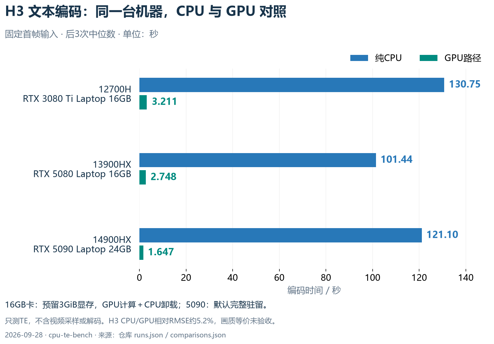
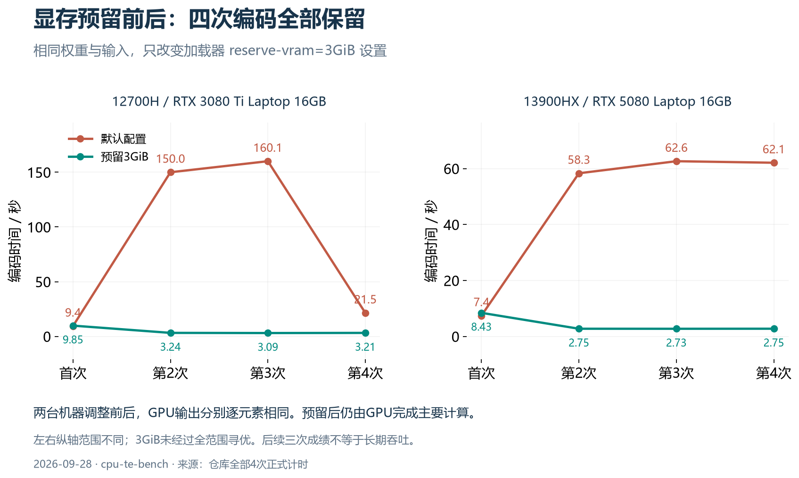
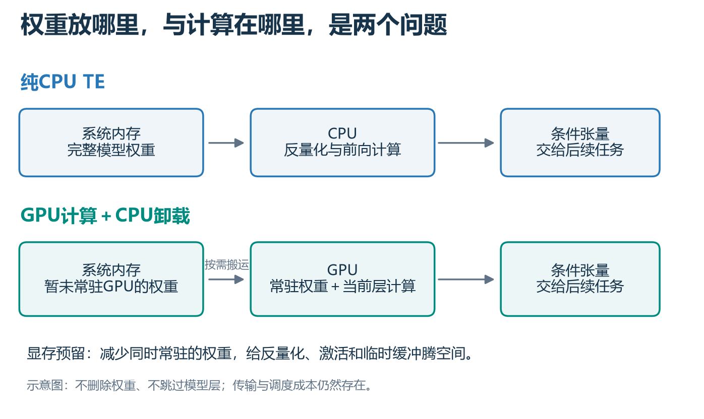

# CPU TE Bench：把文本编码器搬到CPU的一次实测

**简体中文** | [English](README.en.md)

Windows / ComfyUI 下的 Image 与 MiniMax H3 文本编码器 CPU–GPU 配对实验：**三台笔记本、80次正式编码、完整保留慢样本与限制。**

这个项目来自“牧群／拼好卡”架构中的一个问题：单卡资源受限时，能否让CPU设备承担文本编码，让GPU专注后续生成？我们跑通了CPU前向，也发现显存分配策略会让GPU成绩差出很大一截。发布的是实验脚本与证据，不是生产服务或一键视频生成器。

> **当前结论：这三台机器优先使用GPU＋合理卸载。纯CPU可作为备用与闲置资源利用路径，不是普遍提速方案。H3 CPU/GPU输出相对RMSE约5.2%，最终画质等价尚未验证。**

## 同机成绩

2026-09-28实测，单位秒。每格为 **CPU / GPU** 的后3次中位数；首次另列于[全部计时](docs/RESULTS.md)。短/长指Image提示词，不指生成分辨率或视频时长。

| 同一台机器 | Image短输入 | Image长输入 | H3固定首帧 | H3 GPU配置 |
|---|---:|---:|---:|---|
| 12700H / RTX 3080 Ti Laptop 16GB | 15.13 / 0.236 | 51.57 / 1.728 | 130.75 / 3.211 | 预留3GiB，GPU计算＋CPU卸载 |
| 13900HX / RTX 5080 Laptop 16GB | 8.19 / 0.181 | 39.54 / 1.418 | 101.44 / 2.748 | 预留3GiB，GPU计算＋CPU卸载 |
| 14900HX / RTX 5090 Laptop 24GB | 9.87 / 0.137 | 34.15 / 0.892 | 121.10 / 1.647 | 默认，权重完整驻留GPU |

这里只测TE编码，H3还包含固定首帧视觉编码；**不是完整生图或5秒视频的生成时间**。CPU禁CUDA、使用FP32计算配置；GPU采用独立TE加载路径、禁用DynamicVRAM。Image短/长输出为24/1016个位置；H3为441个位置。



## 更重要的发现：给显存留空间，反而快了

两张16GB卡的H3默认配置出现严重波动，追加组只改加载器参数 `--reserve-vram 3`，不改权重或输入。

| GPU | 默认4次，秒 | 预留3GiB后4次，秒 |
|---|---|---|
| RTX 3080 Ti Laptop | 9.448 / 149.974 / 160.068 / 21.477 | 9.851 / 3.235 / 3.087 / 3.211 |
| RTX 5080 Laptop | 7.432 / 58.316 / 62.629 / 62.080 | 8.430 / 2.748 / 2.734 / 2.755 |

两机调整前后GPU输出分别逐元素相同。预留会让更多权重留在CPU内存、按需搬到GPU，腾出反量化、激活与临时缓冲空间；主要计算仍在GPU。3GiB是加载预算，不是驱动硬上限，也没有被证明是通用最优值。





这说明不能把历史约70秒GPU成绩当作普遍基准，也不能将“CPU只多约30秒”当作H3的固有特点。[机制与边界](docs/FINDINGS.md)

## 仓库包含什么

- `scripts/bench.py`：实际跑测脚本的原样副本，CPU/GPU各4次，内存保护、CUDA同步、可选GPU诊断。
- `archive/bench-main.py`：加入显存预留参数前的主矩阵版本。
- `results/2026-09-28/runs.json`：14个进程组的脱敏记录，包含全部80次正式计时、内存、设备、权重/源码哈希及5次Profiler摘要。
- `results/2026-09-28/comparisons.json`：9组CPU/GPU数值对比和两组预留前后比较。
- `scripts/analyze_recorded.py`：仅用Python标准库重新生成计时表，不启动模型。
- [复现方法](docs/REPRODUCE.md)、[发现与未知项](docs/FINDINGS.md)、[数据字段](docs/DATA_DICTIONARY.md)。

模型权重、原始参考图、输出条件张量不分发。**H3方法可在自有图片上复用，但缺少原图时不能逐字节复现本仓库历史H3样本。** 数值差异摘要也不能在没有原输出张量的情况下重新计算。主机名、私有路径、SSH配置、服务快照及凭据已剔除。

## 快速查看结果

```powershell
python scripts/analyze_recorded.py
python -m unittest discover -s tests -v
```

自己跑模型前，请先读[运行要求与完整命令](docs/REPRODUCE.md)。脚本不会安装依赖、下载权重、停止其他服务或改变防火墙。

插图同时提供PNG和SVG。重新画图需要额外安装Matplotlib及中文字体，再运行 `python scripts/plot_results.py`；该脚本只读取已归档数据，不启动模型。普通结果分析不需要这些绘图依赖。

## 已知限制

- H3 CPU/GPU输出相对RMSE约5.20%～5.22%，余弦约0.99938。形状正确、无NaN不等于最终画质等价。
- 三台机器为40/48/48GiB DDR5-4800，线程14/24/24；电源、CPU温度与后台环境未做实验室级统一，不作CPU型号排名。
- 第一轮前已完整读取文件做SHA校验，不是真正磁盘冷启动；Image长用例之前已执行短用例。
- 后3次中位数不代表长期生产吞吐；没有跑DiT/VAE、最终媒体、并发流水线或物理无GPU主机安装验收。
- 当前GPU TE路径中观察到FP32 SGEMM与NVFP4反量化，不能把NVFP4文件名称等同于原生FP4运算。

## 参与

欢迎补充其他CPU、显卡、RAM配置或运行后端的同机结果。请同时提供：权重SHA、输入/预处理一致性、首次＋多次重复、CPU是否初始化CUDA、GPU卸载策略、内存峰值及输出误差。不要只发一个最快数字。

本项目代码与文档采用MIT许可证；ComfyUI、模型和其他依赖遵循各自许可证。模型名称用于标识测试对象，不代表官方背书。
